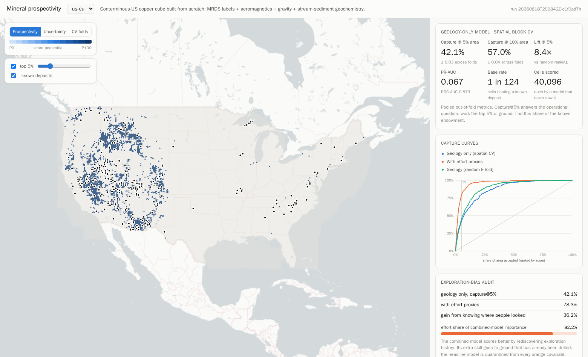

# Mineral prospectivity mapping, done honestly

An end-to-end system that ranks ground by its chance of hosting an undiscovered
mineral deposit, and, more to the point, a set of controls for the three ways
this task quietly goes wrong.

The modeling here is deliberately unexciting: gradient-boosted trees on a
hexagonal grid. The interesting work is everything around it. A naive version of
this project reports ROC-AUC of 0.98 and produces a map that is worthless on any
ground you have not already drilled. This one reports 0.95 and explains the
difference.

> **Provenance:** this is an exploratory project, built in a few working
> sessions with heavy assistance from an AI coding agent (Anthropic's Claude).
> The direction, the judgment calls (label definitions, covariate quarantine,
> what counts as a leak), and the verification are mine; most of the
> line-by-line code is not. The app's About page carries the full version.

Six services, one compose file:

- **`mpm etl` + Dagster**: a structured ingest pipeline that *acquires* open
  USGS data (checksummed, cached, retried), *validates* it through
  data-quality gates, *cleans* it (censored geochemistry, BOM'd headers, Null
  Island coordinates, free-text commodity fields), assembles an H3 datacube,
  trains the models, and *publishes* versioned run artifacts. Every stage
  writes a manifest; reruns recompute exactly the stages whose inputs changed.
  The stage functions are orchestrator-free; Dagster wraps them as a
  partitioned asset graph (lineage, run history, a weekly refresh schedule,
  UI proxied at /dagster/).
- **Postgres**, the catalog: the data-source registry (including sources
  registered at runtime through the UI), the run index, per-cell scores in
  queryable form, and Dagster's own storage. Bulk artifacts stay on the
  volume; the catalog can always be rebuilt from them (`mpm etl backfill-db`).
- **`mpm.api`**: a thin FastAPI service over the published artifacts plus
  source management endpoints (host-allowlisted; the pipeline fetches what
  you register).
- **`web/`**: a React + deck.gl app: the map (prospectivity, uncertainty,
  CV folds, top-N% shortlist), plus About / Research / Breakdown /
  Architecture pages that explain what everything means, where the ideas come
  from, and how the system fits together. The Architecture page includes the
  live source catalog: pick from curated, verified-parseable USGS additions
  (soil and heavy-mineral-concentrate geochemistry) or register a custom
  grid/geochem URL, then click "Materialize in Dagster". That button launches
  a real Dagster run through its GraphQL API (`POST /api/materialize`), so
  the rebuild shows up in the Dagster UI with lineage and logs, and the new
  source is in the next cube with no code change.

The stack publishes exactly one port, bound to loopback: `127.0.0.1:8080`.
Deploying behind a host-level reverse proxy is therefore just "proxy the
subdomain to localhost:8080"; the Dagster UI rides along at `/dagster/` on
the same origin, behind the same TLS and auth, with no separate port open.
(Set `MPM_BIND=0.0.0.0` only if you genuinely want the port exposed.)

```bash
docker compose up --build         # synth profile -> 127.0.0.1:8080 (dagster at /dagster/)
MPM_PROFILE=us-cu docker compose up --build   # real-data US copper cube

# or, without docker:
pip install -e ".[dev,api,orchestration]"
python -m mpm etl run --profile us-cu --data-root data
uvicorn mpm.api:app &             # api on :8000
cd web && npm install && npm run dev          # frontend on :5173
```

The basemap tiles come from CARTO, which requires an API key. Put
`MAPS_API_KEY=<key>` in a `.env` at the repo root (gitignored); compose passes it
into the frontend build as `VITE_CARTO_KEY`. It is a public client-side
credential, baked into the built bundle and readable in devtools, so it is
protected by the domain restriction you set in the CARTO dashboard rather than by
secrecy. Without it every data layer still renders and the basemap tiles come
back watermarked.



---

## The three problems

### 1. Absence is not evidence of absence

You have ~10² known deposits and ~10⁶ cells. The other cells are **unlabeled**,
not negative. A cell with no recorded deposit is either barren or hosting an
orebody under 400 m of cover that nobody has drilled. Train a standard
classifier that treats them as negatives and you teach it that undiscovered
deposits look like background, precisely the class of cell you are trying to
find.

This is a positive-unlabeled (PU) problem. `mpm/pu.py` implements:

- **PU bagging** (Mordelet & Vert 2014). Each ensemble member sees all
  positives plus a small draw of unlabeled cells cast as negatives. A hidden
  positive is contradicted by the members that did not draw it, rather than
  burned in by all of them. Ensemble spread falls out for free as an
  uncertainty estimate.
- **Informed negative sampling.** A first pass scores the unlabeled pool; the
  second pass draws pseudo-negatives preferentially from cells the first pass
  finds *unlike* the positives. Tabular analog of the undersampling scheme in
  GFM4MPM (Mohammadi et al. 2024).
- **The Elkan–Noto constant** `c = P(labeled | y=1)`, estimated on positives
  each bag holds out. Estimating it on training positives (my first attempt)
  returns a meaningless 0.995, because a bag trained on every positive
  recognizes every positive.

One caveat stated plainly in the code: Elkan–Noto assumes SCAR (labeled
positives selected completely at random). Exploration data violates that by
construction: discovery depends on outcrop, road access and historic land
tenure. So `c_hat` is a diagnostic, not a calibration guarantee. Problem 3 is
what that violation costs you.

### 2. Random k-fold cross-validation leaks

Geophysical grids are smooth and geology polygons span many cells, so a random
split puts near-duplicates of every test cell into training. The model memorizes
location.

`mpm/splits.py` holds out contiguous **spatial blocks** (H3 parents at
resolution 3, ~12,400 km² each), clustered into regions and packed into folds by
a longest-processing-time greedy that balances cell count *and* positive count
simultaneously. Training cells within a configurable distance of any held-out
cell are then dropped, using an exact haversine BallTree buffer rather than a
block-quantised approximation.

The pipeline runs the naive protocol alongside the honest one so the gap is a
number rather than an assertion:

| | spatial block CV | random k-fold | inflation |
|---|---|---|---|
| ROC-AUC | 0.948 | 0.974 | **+0.026** |
| capture@5% | 0.640 | 0.865 | **+0.225** |

That contrast is the single most useful result in the repo. The metric the
literature reports is nearly blind to the leak. The metric a drilling budget
cares about inflates by 35% relative.

### 3. Deposits are recorded where people looked

Known deposits cluster near roads, near outcrop, near historic workings. A model
handed accessibility covariates will happily become a *where-have-people-looked*
detector, score beautifully against known deposits, and send you to ground that
has already been drilled out.

Two controls:

**Quarantine.** Covariates matching effort patterns (`road`, `pop`, `outcrop`,
`sample_density`, `dist_to_deposit`, …) are split out by name in `config.py`.
The headline model never sees them. A second model does, and the difference is
reported:

```
geology_only_capture@5%           0.640
with_effort_capture@5%            0.802
effort_gain                       0.162
effort_importance_share           0.787   <- effort takes 79% of model importance
```

`outcrop_frac` is the judgment call worth defending in conversation. Exposure is
a genuine geological property, but in this system it only affects *detection*,
not *formation*, so it belongs in the effort group. Real cubes are full of
covariates that sit on that line.

**The synthetic cube.** This is why `mpm/synth.py` exists. On real data you can
only validate against *discovered* deposits, so a road-proximity detector scores
brilliantly and nothing catches it. The generator knows three things the model
does not: latent favorability, every deposit that exists, and the probability
each was ever recorded. Deposits are found only where a biased detection process
(accessible, outcropping, well-sampled ground) reached them.

So you can ask the question real data refuses to answer:

```
n_true_deposits            404
n_discovered               111      (discovery rate 0.275)
known_capture@5%           0.640
undiscovered_capture@5%    0.645    <- the number that actually matters
```

The geology-only model ranks deposits it was never shown as well as ones it was.
That is the payoff for the quarantine, and it is unmeasurable without a
simulator.

---

## Results on the synthetic cube

27,460 cells, 111 labeled deposits, base rate 1 in 247. Full run: ~28 seconds.

```
HEADLINE  (geology covariates, spatial block CV, pooled out-of-fold)
  capture@5%         0.6396   (per-fold sd 0.2025)
  capture@10%        0.8739   (per-fold sd 0.1242)
  lift@5%           12.7928
  pr_auc             0.0640
  roc_auc            0.9481
```

Metrics are **pooled out-of-fold**: computed once over every cell, each scored by
a model that never saw it. With ~20 positives per fold, a per-fold mean of
capture@5% is mostly sampling noise; per-fold spread is reported separately as a
stability estimate, not a point estimate.

Covariate importance recovers the generative structure: the four causal drivers
on top, the three decoys at the bottom:

```
dist_craton_edge_km   0.312     decoy_smooth   0.012
carbonate_frac        0.264     decoy_rough    0.006
heatflow_mwm2         0.193     decoy_white    0.004
sed_thickness_km      0.117
```


`results/figures/prospectivity_map.png` shows the score surface with known
deposits and (for the synthetic cube) undiscovered ones overlaid, beside an
ensemble-disagreement surface. That second panel is the operationally useful
one: a high score every bag agrees on is a very different proposition from a
high score the ensemble is split on, and ranking on the mean alone throws the
distinction away.

---

## Why these metrics

ROC-AUC is the default in the MPM literature and is close to useless at a
1-in-250 base rate; it is dominated by how well the model orders the barren
majority against itself. Reported here only for comparability, and to show how
little it moves under a leak.

The question a drilling program actually asks is: *if I can work 5% of this land
package, what fraction of the endowment do I capture?* That is the **capture
curve** (the prediction-rate curve of Cheng & Agterberg 1999). H3 cells are
near-equal-area, so "top 5% of cells" is "top 5% of area" for free.

For calibration against the literature: a 2026 porphyry-copper study using the
same combination of PU learning, spatial block CV and effort-proxy separation
reports PR-AUC of 0.036 and recovers 26.75% of known deposits in the top 5% of
cells. Numbers in that range are what honest evaluation looks like. Papers
reporting AUC of 0.99 are usually reporting leakage.

---

## The ingest pipeline

`mpm etl` is the production-shaped part of the repo: a staged, manifest-driven
pipeline in the spirit of a structured ingest system.

```
acquire ──┬─ labels ────┐
          ├─ geophys ───┤
          ├─ geochem ───┼─ cube ── train ── publish
          └─ extras ────┘
```

```bash
python -m mpm etl profiles                          # what can be built
python -m mpm etl run --profile us-cu --data-root data
python -m mpm etl status --data-root data           # stage freshness, latest runs
python -m mpm etl run --profile us-cu --force cube  # surgical rebuild
python -m mpm etl backfill-db --data-root data      # rebuild catalog from artifacts

# the same stages, orchestrated (lineage, partitions, schedule):
dagster dev -f src/mpm/orchestration/defs.py
```

`extras` are sources registered at runtime in the Postgres catalog (via the
web UI's Architecture page or `POST /api/sources`): additional `xyz_grid`
files or NGDB-style `ngdb_geochem` zips from allowlisted hosts. The covariate
name you give a source decides which side of the bias audit it lands on; the
quarantine list is the arbiter, visibly.

The `us-cu` profile builds a conterminous-US copper cube from scratch, from
four open USGS sources (~220 MB total, fetched once and cached):

| source | role | the cleaning it needs |
|---|---|---|
| MRDS occurrences | labels + effort proxies | free-text commodities, Null Island rows, name dedup, prod-size filter |
| aeromagnetic grid | covariate | headerless lon/lat/nT triples → per-cell mean + roughness |
| gravity grids (isostatic, Bouguer) | covariates | same |
| NGDB stream sediments | covariates + effort | censored values encoded as *negative detection limits*, mixed ppm/pct units, log-normal tails |

Design decisions worth defending in conversation:

- **Positives are Large/Medium producers only** (323 cells, 1-in-124 base
  rate). Include every "small producer" and the label set balloons to 2,630
  cells of one-adit historical workings; the label stops meaning *orebody*.
- **`dist_to_deposit_km` is computed leave-self-out.** The first version
  wasn't, which made the column a copy of the label and the combined model a
  perfect-scoring fraud (PR-AUC 1.000). The test suite now pins this.
- **Missingness indicators are quarantined as effort.** "No geochem sample
  here" is a fact about surveying, not rocks; `_isna` flags go to the audit
  model, never the headline model.
- **Stage manifests store paths relative to the stage directory**, so the same
  data volume is fresh whether the pipeline ran on the host or in a container.
- **Checksums are recorded, not pinned** (USGS revises compilations in place);
  a changed upstream file automatically invalidates exactly the stages built
  from it. Pin `sha256` in `sources.py` to freeze a vintage.

On that real cube, the honest headline is capture@5% = 0.42 (geology only,
spatial CV, top drivers: Bouguer gravity, Cu/Zn/As stream-sediment
geochemistry). The bias audit then shows what contamination buys: add effort
proxies and capture jumps to 0.78 with 82% of model importance sitting on
effort covariates: a model that would send every drill rig to ground the
industry already knows.

## The web app

`docker compose up` brings up the whole stack: Postgres, the one-shot pipeline,
the Dagster webserver and its daemon, the API, and nginx serving the built React
app (proxying `/api` and `/dagster/`).

- **Map**: score surface (percentile-binned sequential ramp), ensemble
  disagreement, and the spatial CV blocks; known deposits and, on the
  synthetic profile, the undiscovered ones the model has never seen. The
  "top N%" slider is the drill-shortlist view: everything else fades out.
- **Panels**: pooled metrics, capture curves with the 5% operating point,
  the exploration-bias audit, validation-honesty (spatial vs random CV), the
  discovery audit, covariate importance colored geology-vs-effort, and the
  provenance of every byte that went into the run.

## Real data, other routes

`scripts/prepare_cube.py` still converts externally downloaded datasets into
the pipeline's schema.

**Recommended: the Lawley et al. datacube.** H3-indexed covariates and labels
for MVT and clastic-dominated Zn-Pb deposits across the US, Canada and
Australia: geophysics, lithospheric structure, geology, geochronology, already
joined onto a resolution-7 grid. It is also a *published benchmark*, so your
number has something to sit next to.

- Datacube: NRCan Open File 8836, <https://doi.org/10.4095/329203>
- Paper: Ore Geology Reviews 141:104635, <https://doi.org/10.1016/j.oregeorev.2021.104635>
- USGS companions: [gridded geology](https://www.sciencebase.gov/catalog/item/623a013ed34e915b67cddcfa),
  [published model grids](https://data.usgs.gov/datacatalog/data/USGS:619552fbd34eb622f6906b26)

```bash
python scripts/prepare_cube.py gridded \
    --covariates ~/data/lawley_datacube.csv \
    --h3-col H3_Address --label-col Training_MVT_Deposit \
    --out data/mvt_cube.parquet

python -m mpm run --cube data/mvt_cube.parquet --config configs/default.yaml --out results
```

**Harder path, more engineering to show:** build the cube yourself from
[USGS MRDS](https://mrdata.usgs.gov/mrds/) occurrences plus
[SGMC geology](https://doi.org/10.3133/ds1052). `mpm/ingest.py` handles the part
that actually bites: occurrence databases are compilations of compilations, so
the same orebody appears under three names with coordinates a kilometer apart,
commodity fields are free text, and "occurrence" spans a producing mine to a
roadside malachite stain. Deduplication runs in two stages (normalized name
within a cell, then cell) because the cell is the unit of prediction and
double-counting silently upweights well-endowed districts.

Those labeling decisions move the result more than the choice of classifier
does.

---

## Layout

```
src/mpm/
  config.py      typed config; effort-pattern quarantine list
  synth.py       biased-discovery simulator with hidden ground truth
  ingest.py      point dedup, H3 indexing, cube cleaning
  splits.py      spatial block folds, LPT packing, haversine buffering
  pu.py          PU bagging, informed negatives, Elkan-Noto
  evaluate.py    capture curve, PR-AUC, bias audit
  pipeline.py    CV orchestration, pooled metrics, discovery audit
  plots.py       map, capture curves, importance
  report.py      report assembly shared by CLI and pipeline
  api.py         FastAPI service over published runs
  db.py          optional Postgres catalog (sources, runs, cells); graceful file-mode fallback
  etl/
    sources.py   registry of upstream datasets (url, citation, optional pin)
    acquire.py   cached, checksummed, retrying downloads
    readers.py   format-hostile parsing (MRDS, XYZ grids, NGDB censoring + BOMs)
    gridding.py  point/grid -> H3 cell aggregation
    validate.py  data-quality gates between stages
    stages.py    manifest-based stage freshness
    profiles.py  named end-to-end configurations
    flow.py      the DAG; label/leak decisions live here
    publish.py   versioned web artifacts (cells, curves, report, provenance)
  orchestration/
    defs.py      Dagster asset graph over the stage functions (partitions = profiles)
web/             React + deck.gl frontend (map + About/Research/Breakdown/Architecture)
docker/          Dockerfiles, nginx config, dagster.yaml; docker-compose.yml at the root
tests/           57 tests, focused on silent-failure paths
scripts/         external-data preparation
configs/         every knob that changes a result
```

Tests target the places where a bug produces a *plausible-looking but wrong*
map: fold leakage, buffer distances, capture-curve arithmetic, label dedup,
whether the simulator's bias engine is actually biased. Two examples of that
paying off during development:

- The first fold-balancer starved a fold to 75 of 27,460 cells. Deposits cluster
  into districts, so balancing on positives alone dumps every zero-positive
  region into one bin. Fixed with LPT ordering on a joint normalized cost.
- A decoy covariate initially ranked as the top predictor. Over a 1000 km domain
  with 250 km wavelengths there are only ~16 effective degrees of freedom, so
  "independent" smooth fields correlate at 0.67 by chance. The decoys are now
  orthogonalised against the drivers. That collinearity is real in actual
  potential-field data, which is a good reason to treat feature-importance
  rankings in published prospectivity models with more skepticism than they
  usually get.

## Known limits

- Cell-level classification with no 3D component. Real targeting cares about
  depth, and the covariates here are surface or lithospheric-scale.
- Positives are cells, not tonnages. A world-class orebody and a showing count
  the same. Grade-tonnage weighting would change the ranking materially.
- The Elkan–Noto `c_hat` stays high (~0.95) because held-out positives sit in
  the same districts as training positives *within* a fold. It measures
  generalisation across positives, not the discovery rate.
- Buffering assumes isotropic distance. Geological continuity follows structure,
  not circles; a strike-aware buffer would be stricter and more correct.

## Where this is going

Mostly not built yet, recorded here so the direction is legible. The storage
seam described at the end is the exception: it is in the code. The branch
checklist lives in `docs/ai-scaffold-pr.md`.

Everything above runs as a single unit: pipeline, orchestrator, API and frontend
sharing one machine, one Postgres, and one `./data` volume. That is the right
shape for a demo and the wrong shape once there is real compute behind it. The
orchestrator wants resources, credentials and privacy. The public read path wants
none of those things and should not be able to reach them.

The split:

- **A private orchestration system.** Dagster, the pipeline, and their own
  Postgres, sized for the work and not publicly reachable. It holds the upstream
  fetch credentials and does all of the writing.
- **A public application system.** The FastAPI service and the frontend, low
  resource, read only, with no route back into the private side.
- **S3 as the boundary.** `etl/publish.py` already writes immutable run
  directories plus a small `latest.json` pointer, which is the shape object
  storage wants. Putting them in a bucket makes the published run the contract
  between the two systems instead of a shared filesystem.

The prerequisite was a storage seam, and that part is built. `src/mpm/storage.py`
addresses artifacts through a small `Storage` interface over a local directory
or an S3 prefix, and `etl/publish.py` and `mpm/api.py` both go through it. One
environment variable moves the boundary:

```bash
MPM_RUNS_ROOT=s3://bucket/mineral-prospectivity/runs   # path, or s3:// URI
AWS_ENDPOINT_URL=https://us-east-1.linodeobjects.com   # any S3-compatible store
```

Deliberately, only the *published runs* move. The raw download cache and the
stage manifests stay on the private side's local disk, because stage freshness
is built on rename atomicity and cheap stat calls, and object storage offers
neither. What crosses the boundary is the finished artifact, which is the thing
the two systems actually need to agree on.

Two consequences worth naming. The API reads artifacts in bounded chunks rather
than loading them, which is what lets the public node be small: streaming a
192 MB object peaks at about 7 MB of process memory instead of tracking the
object's size. And once `scores.parquet` lives in object storage, the bucket is
a data product boundary rather than shared disk, so a notebook, DuckDB or a BI
tool can read a published run directly without going through the app.

Still on the private side and still local: the stage manifests, the raw cache,
and Dagster's own storage. Splitting those is the next step, not this one.

## References

Mordelet & Vert (2014), bagging SVM for PU learning · Elkan & Noto (2008),
learning from positive and unlabeled data · Roberts et al. (2017),
cross-validation under spatial structure · Cheng & Agterberg (1999),
prediction-rate curves · Lawley et al. (2022), *Ore Geology Reviews* 141:104635 ·
Mohammadi et al. (2024), GFM4MPM, [arXiv:2406.12756](https://arxiv.org/abs/2406.12756)
